# KIRDEV
### Developer · Creator · Experimenter

**Android • Telegram • Windows • Web**

*От идеи до работающего проекта. Свой стиль, свои эксперименты, постоянное развитие.*

---

## 01 / ОБО МНЕ

Привет! Я **KirDev**, независимый разработчик и автор **KirDev Studio**.

Создаю Android-приложения, Telegram-ботов, Windows-утилиты и веб-проекты. Люблю возвращать к жизни старые идеи, переосмыслять интерфейсы и добавлять функции, которыми действительно хочется пользоваться.

**Мой подход:** `Idea → Prototype → Design → Build → Improve → Release`

Работаю с **AI-assisted development / vibe coding**: использую ИИ как инструмент для разработки, анализа и улучшения кода. Проекты проверяю и развиваю постепенно.

## 02 / МОИ ПРОЕКТЫ

<table>
<tr>
<td width="50%" valign="top">

### [KiroX](https://github.com/kirdev07/KiroX-Telegram-client-Android)
**Android · Telegram Client**

Неофициальный клиент Telegram с собственным визуальным направлением **KiroX Fusion UI**.

- **Theme Studio** — расширенная настройка оформления
- **KiroX Flow** — собственные элементы навигации и интерфейса
- Анимации, визуальные эффекты и персонализация
- Центр обновлений и дополнительные экраны настроек

Основан на Telegram for Android. Исходные лицензии и авторство сохраняются.

</td>
<td width="50%" valign="top">

### [Pulse-PC](https://github.com/kirdev07/Pulse-PC)
**Windows · Python · Remote Control**

Инструмент управления компьютером и автоматизации.

- Управление через Telegram
- Мониторинг состояния компьютера
- Управление программами и мультимедиа
- Локальное подключение устройств

Разработка Windows-версии и подготовка первого официального релиза.

</td>
</tr>
<tr>
<td valign="top">

### [Kiro-BOT](https://github.com/kirdev07/Kiro-BOT)
**Android · Automation · Bots**

Проект бота, который развивался через несколько поколений.

- Автоматизация общения
- Работа с ответами и сценариями
- Развитие интерфейса и возможностей
- Эксперименты с ИИ

</td>
<td valign="top">

### [Kiro-Web](https://github.com/kirdev07/Kiro-Web)
**Android · Local Web Server**

Переосмысление Android-веб-сервера на основе DroidPHP.

- Локальное размещение сайтов
- Работа с PHP и серверными компонентами
- Концепция встроенной панели управления
- Модернизация старого Android-проекта

Форк DroidPHP; модернизация в процессе.

</td>
</tr>
<tr>
<td valign="top">

### [FP IHA BOT — Fork](https://github.com/kirdev07/drfailov_iha_bot-by-kirdev-)
**Android · Legacy Revival**

Изучение и адаптация классического проекта FP iHA BOT.

Авторство оригинального проекта принадлежит его создателям; проверка лицензий и совместимости продолжается.

</td>
<td valign="top">

### [KirDev Studio](https://kirdev-studio.vercel.app/)
**Web · Portfolio · Releases**

Мой сайт — единое место для проектов, новостей, описаний и ссылок на исходный код.

Сайт развивается вместе с проектами.

</td>
</tr>
</table>

## 03 / СТЕК И ИНСТРУМЕНТЫ

## 04 / ДИЗАЙН-ПОДХОД

> **Black & White. Motion. Freedom.**

В своих проектах стремлюсь к узнаваемому **чёрно-белому стилю**, плавным анимациям, удобной навигации и глубокой кастомизации. Особенно люблю интерфейсы, которые можно настроить под себя — от тем и акцентов до поведения отдельных элементов.

**KiroX Fusion UI** — одно из направлений, где я экспериментирую с этим подходом.

## 05 / ПУТЬ

`2019–2020` Игровые проекты, SAMP Mobile и первые модификации  
`2020` Эксперименты с Android и ботами  
`2026` KirDev Studio, KiroX, Pulse-PC и возвращение к активной разработке

---

### KIRDEV STUDIO

**CREATE · CUSTOMIZE · EXPERIMENT · RELEASE**

Independent projects. Built with curiosity.

